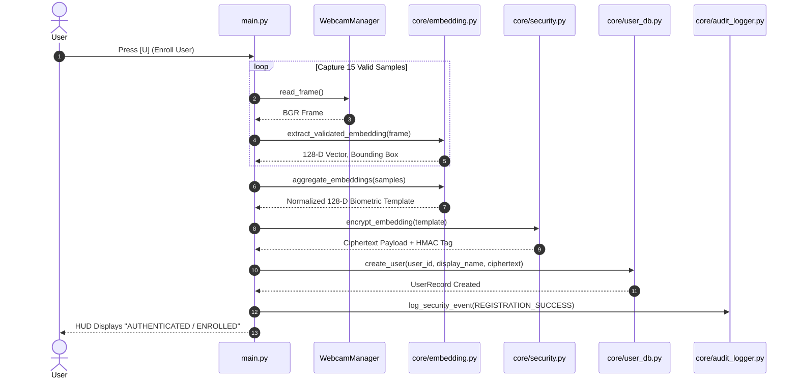
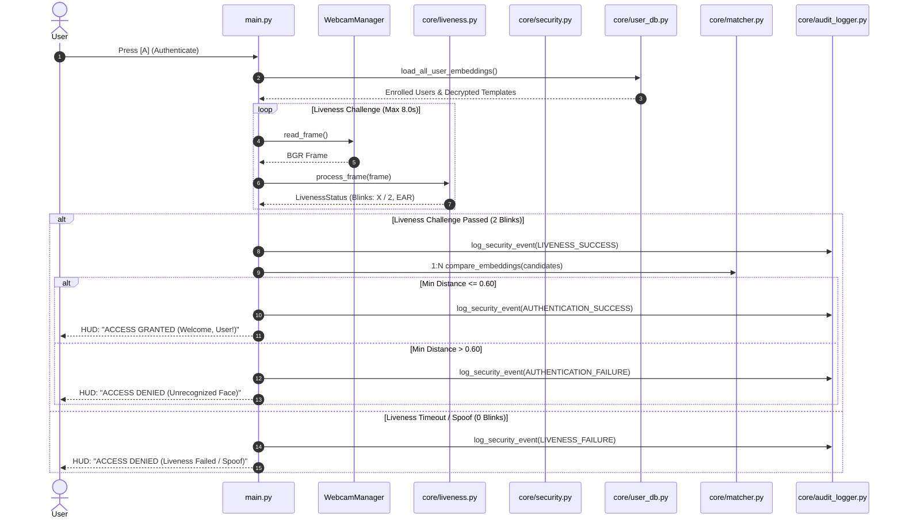

# FaceLock — System Architecture & Technical Specifications

## 1. High-Level Architecture Overview

FaceLock is structured as a modular, decoupled computer vision and biometric security system implemented in Python.

```
┌─────────────────────────────────────────────────────────────────────────────┐
│                           FACELOCK APPLICATION                             │
│                                 (main.py)                                   │
└───────────────┬─────────────────────────────────────────────┬───────────────┘
                │                                             │
    ┌───────────▼───────────┐                     ┌───────────▼───────────┐
    │  WORKFLOWS SUBSYSTEM  │                     │   HUD & UI ENGINE     │
    │  ├── register.py      │                     │   └── ui_renderer.py  │
    │  └── authenticate.py  │                     │       (8 State HUD)   │
    └───────────┬───────────┘                     └───────────────────────┘
                │
    ┌───────────▼─────────────────────────────────────────────────────────────┐
    │                            CORE SUBSYSTEMS                              │
    │  ├── embedding.py   (dlib 128-D ResNet, Quality Gate, Centroid Agg)     │
    │  ├── liveness.py    (Facial Landmarks, EAR Blink Anti-Spoofing)         │
    │  ├── matcher.py     (Euclidean Metric Space Distance & Thresholds)      │
    │  ├── security.py    (AES-128-CBC + HMAC-SHA256 Template Encryption)     │
    │  ├── user_db.py     (SQLite User Repository & Encrypted File Storage)   │
    │  └── audit_logger.py(Append-Only JSON Audit Log & Rotation Policy)      │
    └───────────┬─────────────────────────────────────────────────────────────┘
                │
    ┌───────────▼───────────┐                     ┌───────────────────────────┐
    │   HARDWARE / I/O      │                     │   EVALUATION SUBSYSTEM    │
    │   └── camera.py       │                     │   ├── metrics.py          │
    │       (OpenCV Stream) │                     │   ├── plots.py            │
    │                       │                     │   └── evaluator.py        │
    └───────────────────────┘                     └───────────────────────────┘
```

---

## 2. Component Specifications

### 1. `main.py`
- Runs the real-time OpenCV rendering loop.
- Manages keypress events (`[a]`, `[r]`, `[u]`, `[l]`, `[q]`).
- Binds camera frames to the 8-state HUD rendering engine.
- Traps runtime errors, frame drops, and window closing events.

### 2. `core/embedding.py`
- Converts BGR frames to RGB for dlib ResNet face encoder.
- **Quality Constraint Validation**: Validates that exactly 1 face exists with bounding box $\ge 60 \times 60\text{ px}$.
- **Centroid Aggregation**: Computes element-wise mean across 15 valid sample frames to eliminate high-frequency sensor noise.
- **Hypersphere Projection**: Normalizes the aggregated vector to unit L2 norm: $v \leftarrow \frac{v}{\|v\|_2}$.

### 3. `core/liveness.py`
- Extracts 6-point eye landmark subsets ($[36..41]$ for left eye, $[42..47]$ for right eye).
- Computes real-time Eye Aspect Ratio:
  $$\text{EAR} = \frac{\|p_2 - p_6\|_2 + \|p_3 - p_5\|_2}{2.0 \cdot \|p_1 - p_4\|_2}$$
- Enforces state transitions: `EYES_OPEN` $\to$ `EYES_CLOSED` (1–25 frames) $\to$ `EYES_OPEN`.
- Denies access on static photo presentations or timeout after 8.0s.

### 4. `core/matcher.py`
- Computes Euclidean distance $d(u, v) = \|u - v\|_2$.
- Validates 128-D dimensions and rejects non-finite (NaN / Inf) arrays.
- Compares against dynamic threshold $\tau = 0.60$.

### 5. `core/security.py`
- Cryptographic wrapper implementing Fernet symmetric authenticated encryption.
- Encrypts 1024-byte raw embedding payloads using AES-128-CBC + HMAC-SHA256.
- Manages 256-bit persistent master key in `data/.facelock_secret.key`.

### 6. `core/user_db.py`
- Manages SQLite database `data/facelock_users.db`.
- Enforces alphanumeric user ID validation (`^[a-zA-Z0-9_-]{2,32}$`) preventing path traversal.
- Manages encrypted template files in `data/users/<user_id>/template.enc`.

### 7. `core/audit_logger.py`
- Structured security event logging writing single-line JSON records to `data/logs/security_audit.log`.
- Sanitizes all log arguments to prevent biometric vector or encryption key leakage.
- Enforces log rotation at 2 MB limit with 5 backup archives.

---

## 3. Data Flow Diagrams

### Registration Flow (15-Sample Multi-Frame Enrollment)



---

### Authentication Flow (Liveness-Gated 1:N Biometric Matching)



---

## 4. SQLite & File System Storage Schema

### SQLite Table: `users`
```sql
CREATE TABLE IF NOT EXISTS users (
    user_id TEXT PRIMARY KEY,
    display_name TEXT NOT NULL,
    created_at TEXT NOT NULL,
    updated_at TEXT NOT NULL,
    template_file TEXT NOT NULL
);
```

### Directory Structure
```
data/
├── facelock_users.db          # Structured user metadata
├── .facelock_secret.key       # 256-bit AES master encryption key (0600 permissions)
├── logs/
│   ├── security_audit.log     # Active rotating security audit log
│   └── security_audit.log.1   # Rotated archive log
└── users/
    ├── user_01/
    │   └── template.enc       # Encrypted 128-D vector payload
    └── user_02/
        └── template.enc       # Encrypted 128-D vector payload
```
